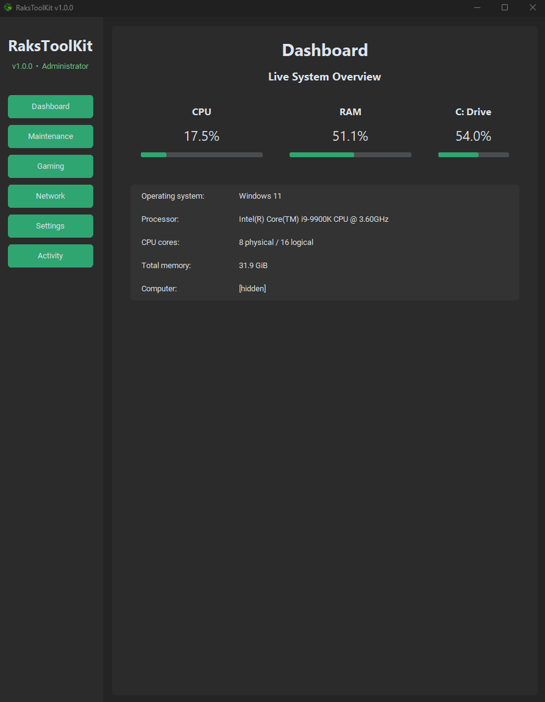
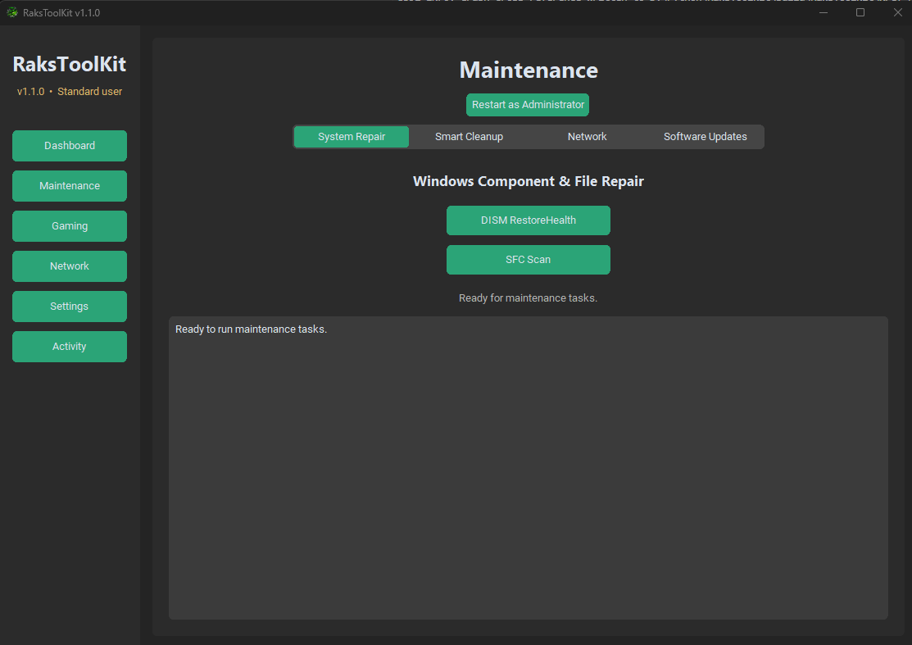
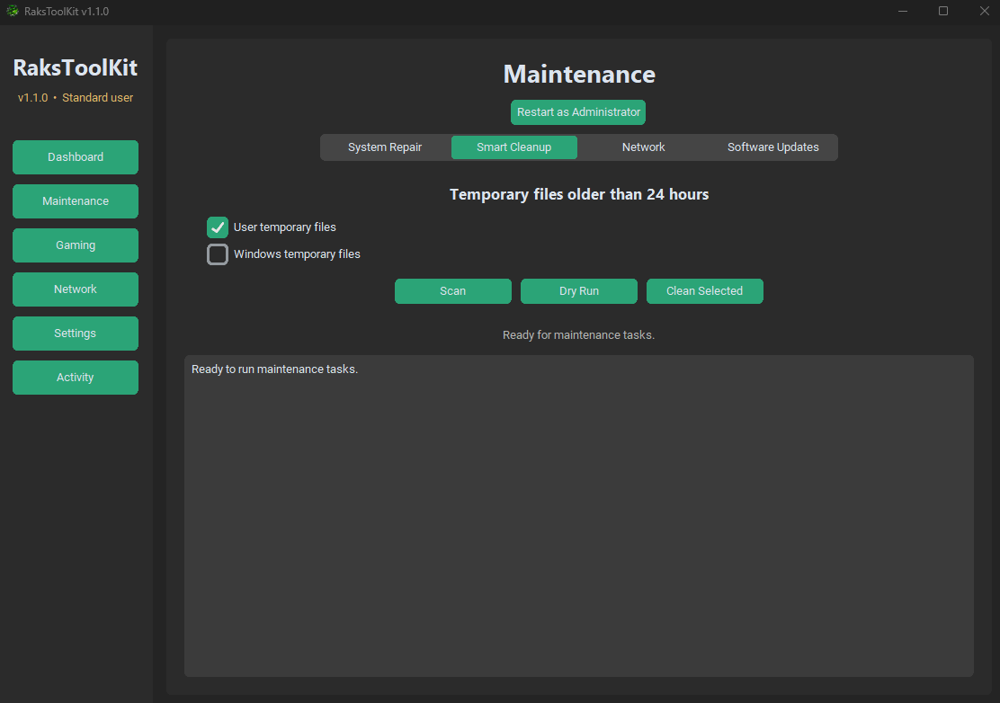
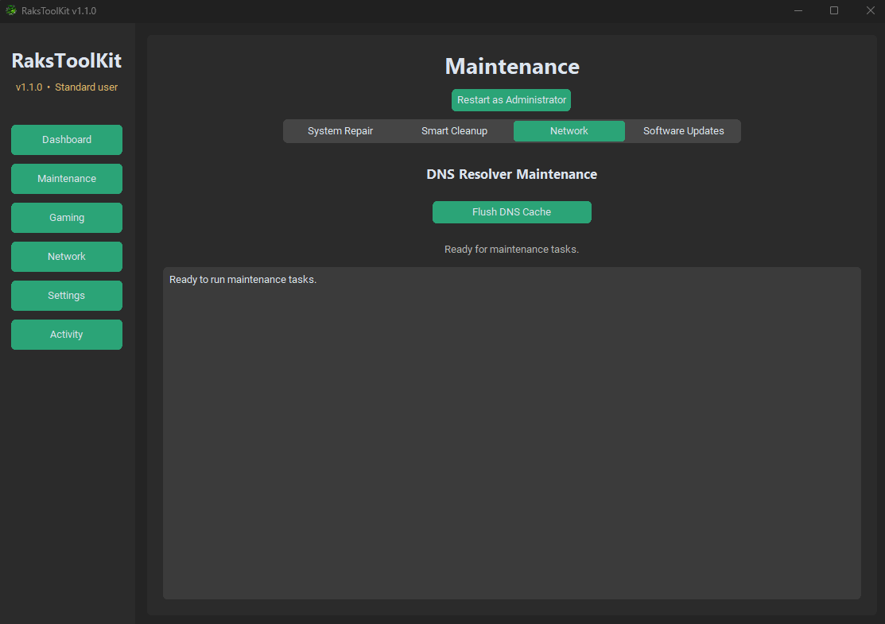
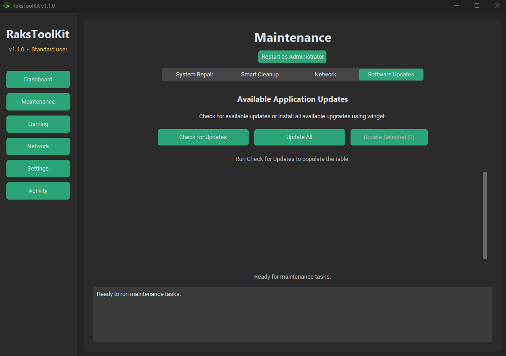
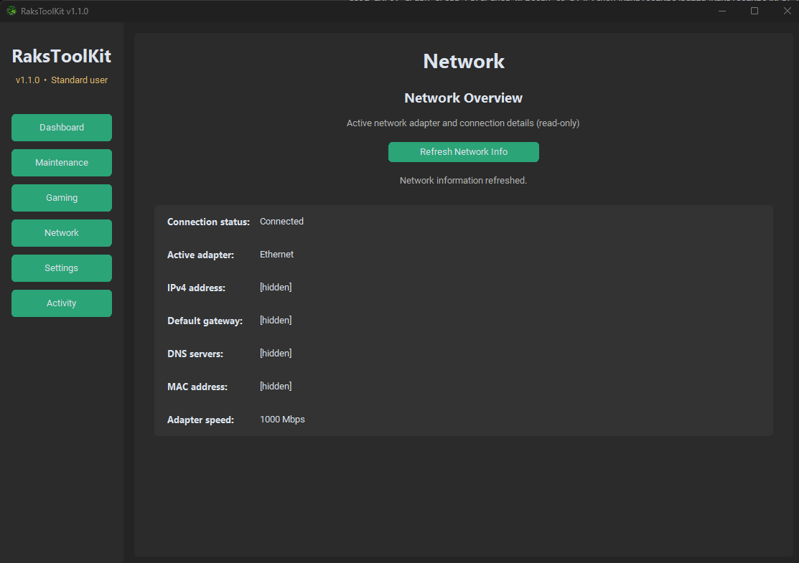
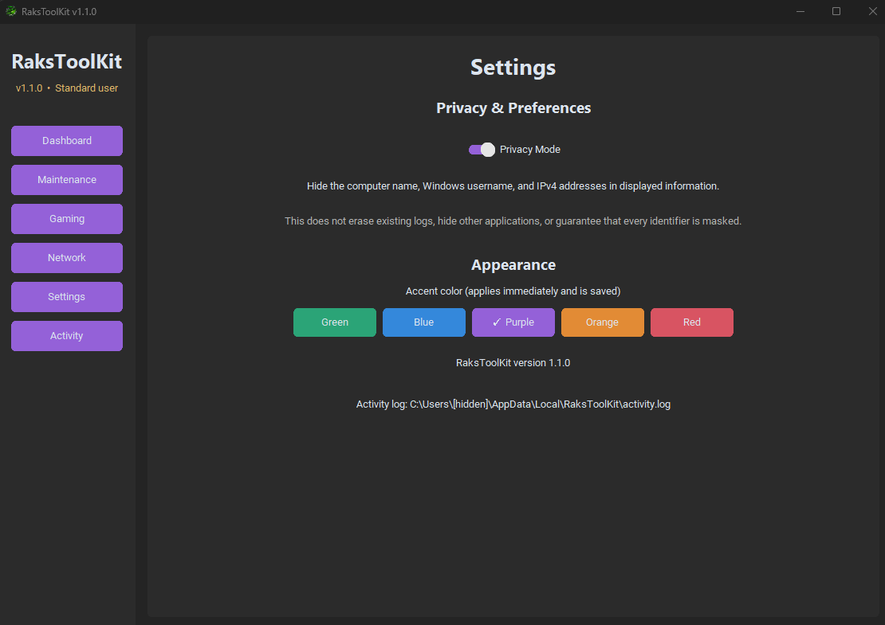
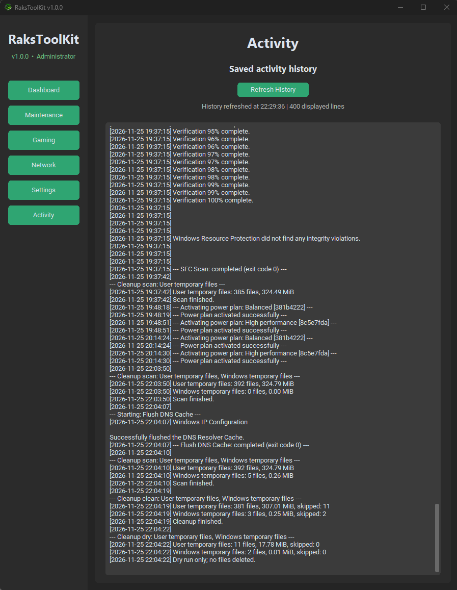

# RaksToolKit

**A Windows maintenance, system monitoring, and gaming utility built with Python.**

RaksToolKit is an open-source Windows desktop application that brings practical system tools into one graphical interface. It provides monitoring, maintenance, gaming utilities, software update checks, and privacy-conscious display options. Download the portable Windows build to use it without installing Python.


## Download for Windows

**Latest stable release: v1.1.0**

**[Download RaksToolKit v1.1.0 for Windows x64](https://github.com/Rakinos89/RaksToolKit/releases/tag/v1.1.0)**

Under **Assets**, download `RaksToolKit-v1.1.0-Windows-x64.zip`, extract the entire archive, and run `RaksToolKit.exe` from the extracted `RaksToolKit` folder. Keep the `_internal` folder beside the executable.

**No separate Python installation or IDE required.**

See [Download and Run](#download-and-run-windows) for installation and security notes.


## Features

### System Dashboard
- Live CPU, RAM, and C: drive usage monitoring
- CPU model and core counts, total memory, and Windows version
- Privacy-aware display of the computer name

### Windows Maintenance
- DISM RestoreHealth and System File Checker (SFC)
- DNS cache flushing
- Administrator privilege detection and elevation
- Background execution with task output and error handling

### Smart Cleanup
- Scan user and Windows temporary folders for files older than 24 hours
- Preview eligible files and estimated space using Scan or Dry Run
- Confirm before deletion; skip inaccessible files and symbolic links

### Software Updates
- Check for available application upgrades using Windows Package Manager (`winget`)
- Review detected applications and their installed and available versions
- Update all detected packages or select individual packages to update
- Review command output and completion status
- Some packages may require administrator privileges or user interaction

### Gaming & Performance
- NVIDIA GPU monitoring via `nvidia-smi`, including utilization, temperature, VRAM, clocks, and power where available
- AMD GPU monitoring through optional ADLX bindings, with available metrics depending on GPU and driver
- Automatic GPU metric refresh on the Gaming page
- Scrollable dashboard with GPU metric cards and usage bars
- Detection of selected running game processes
- Windows power plan management and TCP connection latency testing
- Normalized GPU metric display with graceful fallback for unsupported values

**GPU testing status:** NVIDIA monitoring has been verified on NVIDIA hardware. AMD monitoring passes mocked automated tests but has **not yet been verified on an actual AMD GPU**. AMD metric availability and packaging behavior may vary by driver and hardware.

### Network Overview
- Display network adapter information and connection details
- Handle disconnected adapters and missing information gracefully
- Respect supported Privacy Mode masking for displayed network information

### Privacy Mode
- Settings toggle to mask supported computer name, username, and IPv4 text displayed in the app
- Preference persists between restarts
- Display masking is not complete anonymization; logs and external applications are not automatically redacted

### Activity Logging
- Persistent local maintenance activity history
- Task results and error reporting
- AppData storage under the RaksToolKit application name, with migration of supported older WinToolKit data

### Interface Improvements
- More consistent button appearance when navigating between pages and maintenance tabs
- Clearer software update selection and completion feedback

## Requirements
- Windows 10 or Windows 11 (64-bit)
- For source-code use only: Python 3.10 or newer and dependencies in `requirements.txt`
- NVIDIA GPU metrics require a compatible NVIDIA driver and `nvidia-smi`
- AMD GPU metrics require compatible AMD hardware, drivers, and ADLX support; unsupported metrics may show as unavailable
- Software Updates requires Windows Package Manager (`winget`) for update checks and installations

Some maintenance and update operations require administrator privileges.

## Screenshots

Screenshots of RaksToolKit v1.1.0.

### Dashboard


### Maintenance

**System Repair**



**Smart Cleanup**



**Network Utilities**



**Software Updates**



### Gaming


### Network Overview


### Settings


### Activity History


## Download and Run (Windows)

1. Open the [latest published GitHub release](https://github.com/Rakinos89/RaksToolKit/releases/latest).
2. Download the `RaksToolKit-<version>-Windows-x64.zip` file from **Assets**, not the automatically generated source-code archive.
3. Extract the entire ZIP to a folder of your choice.
4. Open the extracted `RaksToolKit` folder and double-click `RaksToolKit.exe`. Keep the `_internal` folder alongside the executable.

The portable build does not require a separate Python installation. Some maintenance features request administrator privileges. Download only from the official repository; Windows may show a security warning for an unsigned executable.

## Installation from Source (Developers)

Clone the repository:

```powershell
git clone https://github.com/Rakinos89/RaksToolKit.git
cd RaksToolKit
```

Create a virtual environment:

```powershell
python -m venv .venv
```

Install dependencies without requiring PowerShell script activation:

```powershell
.\.venv\Scripts\python.exe -m pip install -r requirements.txt
```

Launch:

```powershell
.\.venv\Scripts\python.exe main.py
```

Run automated tests:

```powershell
.\.venv\Scripts\python.exe -m unittest discover -s tests -v
```

Some tests involving Windows symbolic links may be skipped when the required permissions are unavailable.

## Development Roadmap

| Version | Milestone | Status |
|---|---|---|
| v0.1–v0.3 | Dashboard and navigation | Complete |
| v0.4 | Windows repair tools | Complete |
| v0.5 | Smart Cleanup | Complete |
| v0.6 | Improved UI and activity logging | Complete |
| v0.7 | Gaming and performance tools | Complete |
| v0.8 | Extended NVIDIA monitoring, live Gaming dashboard, Privacy Mode, CPU identification | Complete |
| v0.9 | Portable Windows executable, application icon, distribution ZIP, refresh feedback | Complete |
| Pre-v1.0 | Documentation, license, automated testing, reliability and UI improvements | Complete |
| v1.0.0 | Stable release, RaksToolKit branding, and final packaging | Released |
| v1.1.0 | AMD GPU monitoring, Network overview, Software Updates, and UI improvements | Released |
| v1.2.0 | AMD GPU hardware validation, expanded hardware monitoring, and disk health monitoring | In development |

## Building a Windows Release

From the repository root, on Windows with a configured `.venv` and PyInstaller installed:

```powershell
.\build.ps1
```

The script uses PyInstaller from the virtual environment, bundles the application icon, builds the executable, and writes the portable ZIP and a SHA-256 checksum into `dist`. It does not upload or publish a GitHub release. The icon must exist at `assets/icons/rakstoolkit.ico`.

**Before publishing a new version**, update the application version and the version variable in `build.ps1`, build the ZIP, and test the extracted portable application on Windows.

## Technology Stack
- **Python:** Application logic
- **CustomTkinter:** Desktop interface
- **psutil:** System and process monitoring
- **AMD ADLX bindings:** Optional AMD GPU monitoring
- **Windows utilities and winget:** Diagnostics, maintenance, and software updates
- **PyInstaller:** Windows portable build
- **Git & GitHub:** Version control and releases

## Project Status

**Latest published stable version: v1.1.0**

**Next release: v1.2.0 (in development)**

RaksToolKit is under active development. Version 1.2.0 will focus on AMD GPU hardware validation, expanded hardware monitoring, and disk health monitoring.

AMD GPU monitoring has passed automated tests but still requires validation on physical AMD graphics hardware. Monitoring capabilities may vary depending on hardware and driver support.

## Disclaimer

RaksToolKit is an independent development project. System maintenance, cleanup, and software update operations can modify or delete files and change installed software. Review actions carefully and use the application at your own risk.

## License

Licensed under the **MIT License**. See [LICENSE](LICENSE) for the full terms and copyright notice.
