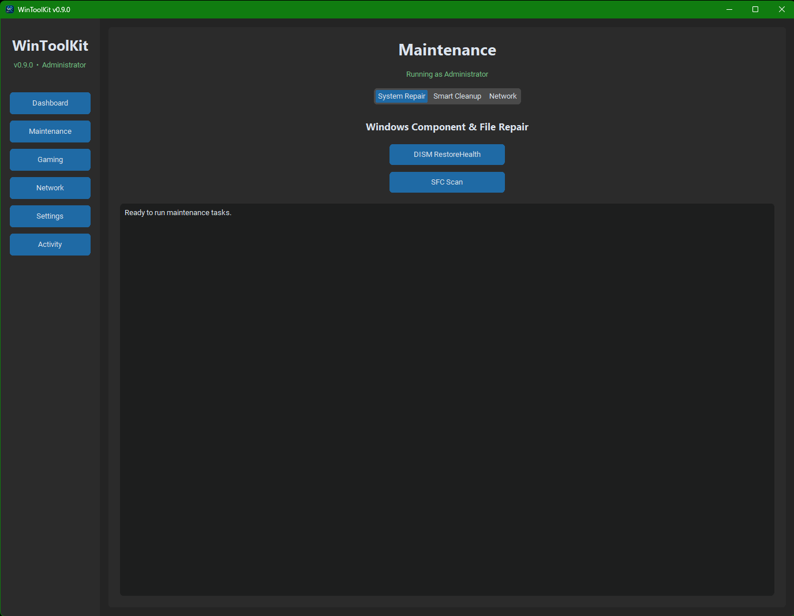
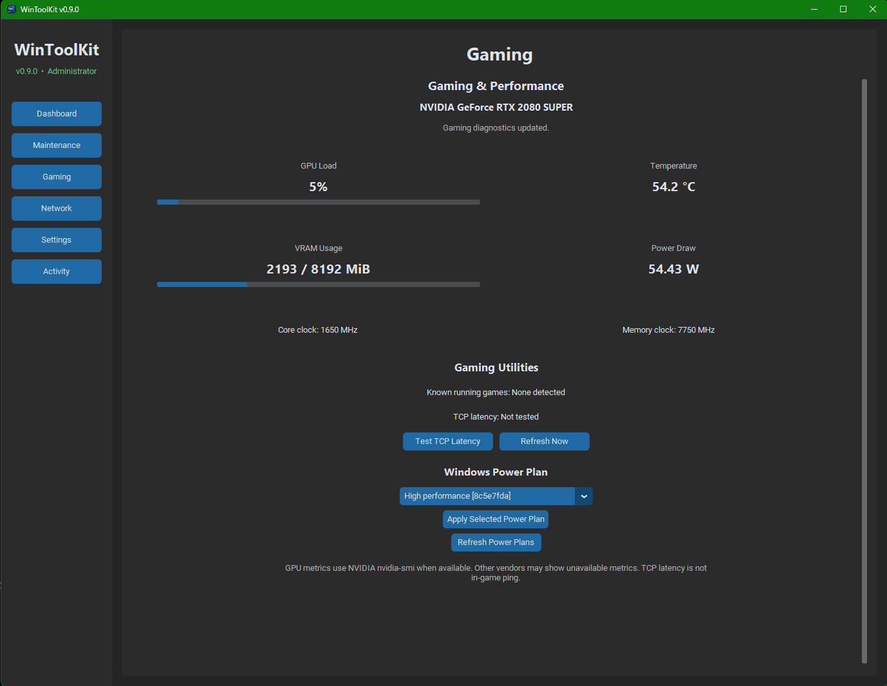
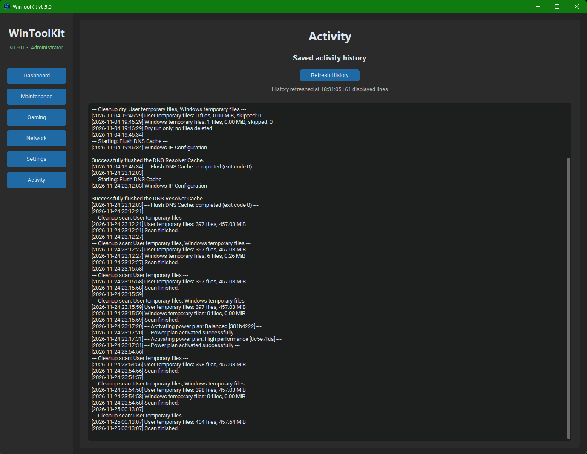

# WinToolKit

**A Windows maintenance, system monitoring, and gaming utility built with Python.**

WinToolKit is an open-source desktop application that brings practical Windows tools into one graphical interface. Development is incremental, with features tested before each release. Windows users can download a portable build without installing Python.

## Download for Windows

**[Download WinToolKit v0.9.0 for Windows x64](https://github.com/Rakinos89/WinToolKit/releases/tag/v0.9.0)**

Download `WinToolKit-v0.9.0-Windows-x64.zip` under **Assets**. Extract the full archive and run `WinToolKit.exe` from the extracted `WinToolKit` folder. Keep the `_internal` folder alongside the executable. **No Python installation or IDE required.**

See [Download and Run](#download-and-run-windows) for details and security notes.

## Features

### System Dashboard
- Live CPU, RAM, and C: drive usage monitoring
- CPU model and core counts, total memory, and Windows version
- Privacy-aware display of the computer name

### Windows Maintenance
- DISM RestoreHealth and System File Checker (SFC)
- DNS cache flushing
- Administrator privilege detection and elevation
- Background execution with task output

### Smart Cleanup
- Scan user and Windows temporary folders for files older than 24 hours
- Preview eligible files and space using Scan or Dry Run
- Confirm before deletion; skip inaccessible files and symbolic links

### Gaming & Performance
- NVIDIA GPU monitoring via `nvidia-smi`, including utilization, temperature, VRAM, clocks, and power where available
- Automatic GPU updates every two seconds on the Gaming page
- Scrollable dashboard with GPU metric cards and usage bars
- Detection of selected running game processes
- Windows power plan management and TCP connection latency testing
- Modular monitoring code designed for future GPU vendor support; AMD monitoring is not yet verified

### Privacy Mode
- Settings toggle to mask supported computer name, username, and IPv4 text displayed in the app
- Preference persists between restarts
- Display masking is not complete anonymization; logs and external applications are not automatically redacted

### Activity Logging
- Persistent local maintenance activity history
- Task results and error reporting

## Requirements
- Windows 10 or Windows 11 (64-bit)
- For source-code use only: Python 3.10 or newer and dependencies in `requirements.txt`
- NVIDIA GPU metrics require a compatible NVIDIA driver and `nvidia-smi`; other adapters may show unavailable metrics

Some maintenance operations require administrator privileges.

## Screenshots

### Dashboard


### Maintenance


### Gaming


### Activity History


## Download and Run (Windows)

1. Open the [GitHub Releases page](https://github.com/Rakinos89/WinToolKit/releases/latest).
2. Download `WinToolKit-v0.9.0-Windows-x64.zip` from **Assets** (not the automatically generated source-code archive).
3. Extract the entire ZIP to a folder of your choice.
4. Open the extracted `WinToolKit` folder and double-click `WinToolKit.exe`. Keep the `_internal` folder beside the executable.

The portable build does not require a separate Python installation. Some maintenance features request administrator privileges. Download only from the official repository; Windows may show a security warning for an unsigned executable.

## Installation from Source (Developers)

Clone the repository:

```powershell
git clone https://github.com/Rakinos89/WinToolKit.git
cd WinToolKit
```

Create a virtual environment:

```powershell
python -m venv .venv
```

Install dependencies without requiring PowerShell script activation:

```powershell
.\.venv\Scripts\python.exe -m pip install -r requirements.txt
```

Launch:

```powershell
.\.venv\Scripts\python.exe main.py
```

## Development Roadmap

| Version | Milestone | Status |
|---|---|---|
| v0.1–v0.3 | Dashboard and navigation | Complete |
| v0.4 | Windows repair tools | Complete |
| v0.5 | Smart Cleanup | Complete |
| v0.6 | Improved UI and activity logging | Complete |
| v0.7 | Gaming and performance tools | Complete |
| v0.8 | Extended NVIDIA monitoring, live Gaming dashboard, Privacy Mode, CPU identification | Complete |
| v0.9 | Portable Windows executable, application icon, distribution ZIP, refresh feedback | Complete |
| Pre-v1.0 | Documentation, license, automated testing, reliability and UI improvements | In progress |
| v1.0.0 | Stable release after final verification and packaging | Planned |
| Future | AMD GPU monitoring and additional hardware support | Planned |

## Building a Windows Release

From the repository root, on Windows with a configured `.venv`:

```powershell
.\build.ps1
```

The script installs/uses PyInstaller from the virtual environment, bundles the icon, builds the executable, and writes the ZIP plus a SHA-256 checksum into `dist`. It does not upload or publish a GitHub release. The icon must exist at `assets/icons/wintoolkit.ico`.

## Technology Stack
- **Python:** Application logic
- **CustomTkinter:** Desktop interface
- **psutil:** System and process monitoring
- **Windows utilities:** Diagnostics and maintenance
- **Git & GitHub:** Version control

## Project Status

**Current version: v0.9.0**

WinToolKit is actively developed and tested incrementally. GPU monitoring availability varies by hardware and driver.

## Disclaimer

WinToolKit is an independent development project. System maintenance and cleanup operations can modify or delete files. Review actions carefully and use the application at your own risk.

## License

Licensed under the **MIT License**. See [LICENSE](LICENSE) for the full terms and copyright notice.
